## {.title-slide-custom}

<div class="cover">

<div class="cover-logo">

</div>


<div class="cover-title">
Aplicación
</div>

<div class="cover-line"></div>

<div class="cover-subtitle">
Capítulo 3
</div>

</div>

<div class="menu-title" style="display:none;">Aplicación </div>

---


::: {.center-vertical}

::: {.chapter-title}

Aplicación 

:::

<div class="chapter-line"></div>

::: {.chapter-subtitle}

Representación del estado del satélite

<div class="menu-title" style="display:none;"> ▸ Representación del estado del satélite</div>
:::

:::
---


::: {.columns}

::: {.column}

<div class="vspace-3"></div>

- El **estado de un satélite** está conformado por su **posición** y **velocidad** en un instante de tiempo dado.

$$
x(t) = \begin{bmatrix}
\vec{r}(t)\\
\vec{v}(t)
\end{bmatrix} \in \mathbb{R}^6
$$

- Al estado $x(t)$ es un instante de tiempo $t$ se le conoce como **efeméride**.

- Sin embargo, para fines prácticos, representar el estado de un satélite con seis variables cartesianas no es la mejor opción, ya que no permite describir de manera intuitiva la trayectoria del satélite.

- Para ello, existen conjuntos de variables que lograr una descripción más intuitiva de la trayectoria y de la posición del satélite en ella.

- Otro aspecto importante a considerar es la necesidad de gestionar la información mediante sistemas computacionales, por lo que es necesario que la representación del estado del satélite tenga un formato **compacto y estandarizado**.

:::

::: {.column}

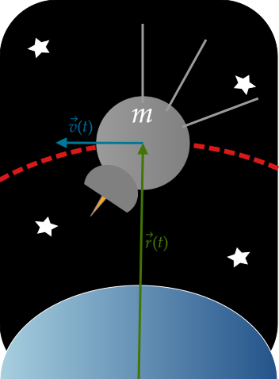{width=70% fig-align="center"}

:::

:::


## Elementos orbitales


::: {.columns}

::: {.column}

- Los **elementos orbitales** (o parámetros keplerianos) son seis variables que permiten describir de manera única la posición de un cuerpo sobre su trayectoria dentro de un marco de referencia base.

- En particular, los elementos orbitales permiten definir:

  - La **<span style="color:red">forma y tamaño</span>** de la trayectoria.


  - La **<span style="color:teal">orientación</span>** de la trayectoria.   


  - La **<span style="color:blue">posición instantánea</span>** del cuerpo en su trayectoria.


:::

::: {.column}

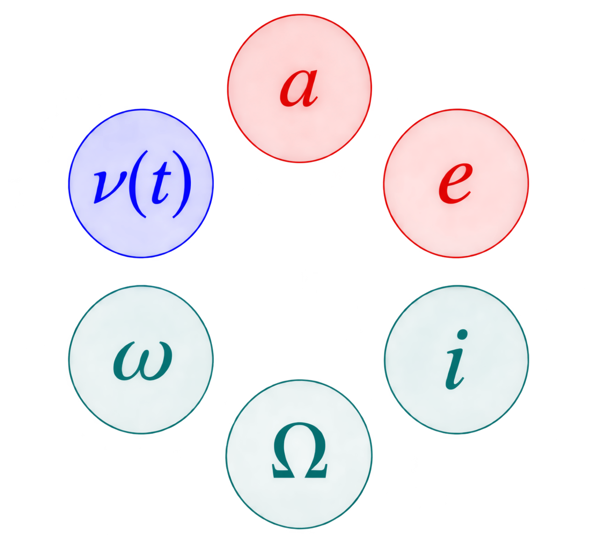{.fragment width=70% fig-align="center"}

:::

:::


---

##

::: {.columns}

::: {.column width="60%"}

La **forma** y el **tamaño** de una órbita se determinan a partir de:


::: {.fragment}

- La <span style="color:red">**excentricidad** $e$</span> mide el grado de deformación de una sección cónica con respecto a una circunferencia. Según el valor de $e$:

  - $e=0$: órbita circular.
  - $0<e<1$: órbita elíptica.
  - $e=1$: parábola.
  - $e>1$: hipérbola.

:::


::: {.fragment}

- En el caso de órbitas elípticas, el <span style="color:red">**semieje mayor** $a$</span> determina su tamaño.

    $$
        e=\frac{c}{a},
        \qquad
        c=\sqrt{a^2-b^2}
    $$

    donde $c$ es la distancia del centro al foco y $b$ es el semieje menor.

- Sin embargo, para trayectorias en general, podemos utilizar el semi parametro $p$ para describir el tamaño de la trayectoria.
:::

:::

::: {.column width="40%"}

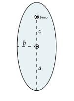{width=100%}

:::

:::

---

##

::: {.columns}

::: {.column width="48%"}

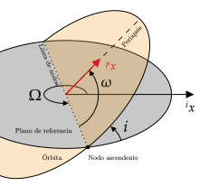{width=120%}

:::

::: {.column width="52%"}

La **orientación de la órbita** se determina con tres ángulos:

:::{.incremental}

- <span style="color:teal">**Longitud del nodo ascendente** $\Omega\in[0,2\pi)$</span>: ángulo en el plano de referencia entre la dirección de referencia y la línea de nodos.
  <div class="vspace-3"></div>

- <span style="color:teal">**Inclinación** $i\in[0,\pi]$</span>: ángulo entre el *plano orbital* y el *plano de referencia*.
  <div class="vspace-3"></div>

- <span style="color:teal">**Argumento del periapsis** $\omega\in[0,2\pi)$</span>: ángulo en el plano orbital entre el nodo ascendente y el periapsis.

:::

:::

:::

---

##

::: {.columns}

::: {.column width="48%"}

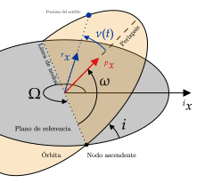{width=120%}

:::

::: {.column width="52%"}

La **posición instantánea** del cuerpo en su órbita se describe con la <span style="color:blue">**anomalía verdadera** $\nu(t)$</span>.


:::{.incremental}
- La anomalía verdadera $\nu(t)$ es el ángulo entre el periapsis y la posición actual del satélite, medido en el plano orbital desde el foco donde se encuentra el cuerpo central.

- Se dice que es *verdadera* porque está presente en todos las posibles secciones cónicas que describen una trayectoria. 

- En lugar de $\nu(t)$, también pueden emplearse otras variables para describir la posición:

  - **Anomalía excéntrica, parabólica o hiperbólica** $\psi(t)$.
  - **Anomalía media** $M(t)$.

- Es importante notar que de los seis elementos orbitales, bajo los suposiciones que hemos hecho hasta el momento, sólo las anomalías varían con el tiempo . 

:::


:::

:::


## Two-Line Element Set (TLE)


::: {.columns}

::: {.column}


Un TLE es un formato estandarizado desarrollado por la Fuerza Aérea de los Estados Unidos. Contiene parámetros orbitales **medios** ajustados a observaciones para describir el movimiento de un objeto artificial alrededor de la Tierra.

- Consta de dos líneas de datos de ancho fijo (69 caracteres).
- La primera línea contiene información de identificación, época y parámetros utilizados para modelar perturbaciones.
- La segunda línea contiene seis parámetros orbitales.
- Puedes contener una línea adicional con el nombre del objeto. En dicho caso, se le conoce como Three-Line Element Set.
- Está diseñado para utilizarse con el propagador SGP4 (Propagador + perturbaciones).


::: {.fragment}

Por ejemplo, el TLE 34 del estación espacial  MIR es:

```text
1 16609U 86017A   93352.53502934  .00007889  00000 0  10529-3 0   348
2 16609  51.6190  13.3340 0005770 102.5680 257.5950 15.59114070447866
```

Es importante notar que las lineas contienen espacios en blanco. Por ejemplo, para el caso anterior podemos indicar estos espacios con el símbolo :

```text
1□16609U□86017A□□□93352.53502934□□.00007889□□00000□0□□10529-3□0□□□348
2□16609□□51.6190□□13.3340□0005770□102.5680□257.5950□15.59114070447866
```

:::

:::

::: {.column}

{width=90% fig-align="center"}

:::

:::


## Línea 1: identificación y época

<div class="vspace-2"></div>


<div class="tle-table">

| Campo | Columnas | Contenido |
|:-----:|:--------:|-----------|
| 1 | 1 | Número de línea. |
| 2 | 3–7 | Número de catálogo del satélite. |
| 3 | 8 | Clasificación: U (no clasificado), C (clasificado), S (secreto). |
| 4 | 10–11 | Designador internacional: últimos dos dígitos del año de lanzamiento. Puede dejarse en blanco. |
| 5 | 12–14 | Designador internacional: número de lanzamiento dentro del año. Puede dejarse en blanco. |
| 6 | 15–17 | Designador internacional: identificador de la pieza del lanzamiento. Puede dejarse en blanco. |
| 7 | 19–20 | Año de la época: últimos dos dígitos del año. |
| 8 | 21–32 | Época: día del año y fracción del día. |
| 9 | 34–43 | Primera derivada del movimiento medio; coeficiente balístico (rev/día²). |
| 10 | 45–52 | Segunda derivada del movimiento medio (rev/día³); se supone el punto decimal. |
| 11 | 54–61 | $B^*$: término de arrastre o coeficiente de presión de radiación, en radios terrestres inversos. Se supone el punto decimal. |
| 12 | 63 | Tipo de efemérides (siempre cero; solo se utiliza en datos TLE no distribuidos). |
| 13 | 65–68 | Número del conjunto de elementos. Se incrementa cuando se genera un nuevo TLE para el objeto. |
| 14 | 69 | Checksum (módulo 10). |

</div>

## Línea 2: elementos orbitales

<div class="vspace-2"></div>

<div class="tle-table">

| Campo | Columnas | Contenido |
|:-----:|:--------:|-----------|
| 1 | 1 | Número de línea. |
| 2 | 3–7 | Número de catálogo del satélite. |
| 3 | 9–16 | Inclinación (grados). |
| 4 | 18–25 | Ascensión recta del nodo ascendente (grados), en el sistema de referencia ECI, medida desde el punto vernal. |
| 5 | 27–33 | Excentricidad (adimensional; se supone el punto decimal). |
| 6 | 35–42 | Argumento del periapsis (grados). |
| 7 | 44–51 | Anomalía media (grados). |
| 8 | 53–63 | Movimiento medio (revoluciones por día). |
| 9 | 64–68 | Número de revoluciones en la época (revoluciones). |
| 10 | 69 | Checksum (módulo 10). |

</div>

---

Tomemos como ejemplo el TLE 34 de la estación espacial MIR:

```text
1 16609U 86017A   93352.53502934  .00007889  00000 0  10529-3 0   348
2 16609  51.6190  13.3340 0005770 102.5680 257.5950 15.59114070447866
```

Podemos seccionarla de la siguiente manera:


---

## Primera línea

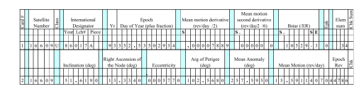{width=70% fig-align="center"}

- **Campo 1: Número de línea.** 

  Siempre es 1 para la primera línea. 

- **Campo 2: Número de catálogo NORAD.**

  Identificador numérico asignado por el **NORAD** (*North American Aerospace Defense Command*) a los objetos espaciales catalogados. Actualmente, la gestión del catálogo corresponde al **18.º Escuadrón de Defensa Espacial (18 SDS)** de la Fuerza Espacial de los Estados Unidos. Los números se asignan conforme los objetos se incorporan al catálogo; no siguen necesariamente el orden de lanzamiento. En este ejemplo, **16609** identifica a la estación espacial MIR.

- **Campo 3: Clasificación del objeto.**

  Indica el nivel de clasificación de la información asociada al objeto: `U` (no clasificado), `C` (clasificado) o `S` (secreto).

  En este ejemplo, **U** indica que la información no está clasificada.

---

## Primera línea

{width=70% fig-align="center"}

- **Campo 4: Año de lanzamiento.**

  Indica los dos últimos dígitos del año en que se lanzó el objeto. En este ejemplo, `86` corresponde a 1986.

- **Campo 5: Número de lanzamiento del año.**

  Indica el número secuencial asignado al lanzamiento dentro de ese año. En este ejemplo, `017` corresponde al lanzamiento número 17 de 1986.

- **Campo 6: Identificador de la pieza del lanzamiento.**

  Identifica al objeto particular asociado al lanzamiento mediante una letra. En este ejemplo, `A` identifica la pieza principal del lanzamiento.

---

## Primera línea

{width=70% fig-align="center"}

- **Campo 7: Año de la época.**

  Indica los dos últimos dígitos del año al que corresponde la época del TLE. En este ejemplo, `93` corresponde a 1993.

- **Campo 8: Época.**

  Indica el instante de referencia de los elementos orbitales, expresado como el día del año y la fracción del día en tiempo UTC.

  En este ejemplo, `352.53502934` corresponde al día 352 (18 de diciembre) de 1993, a las 12:50:26.535 UTC, aproximadamente.


## Primera línea

{width=70% fig-align="center"}

- **Campo 9: Primera derivada del movimiento medio.**

  Corresponde a $\dot{\eta}/2$, donde $\dot{\eta}$ es la primera derivada temporal del movimiento medio. Se utiliza para describir variaciones del movimiento medio asociadas a perturbaciones orbitales, particularmente el arrastre atmosférico.

  En este ejemplo, $\dot{\eta}/2 = 0.00007889\ \text{rev}/\text{día}^2$, por lo que:

  $$
  \dot{\eta} = 2(0.00007889) = 0.00015778\ \text{rev}/\text{día}^2.
  $$

- **Campo 10: Segunda derivada del movimiento medio.**

  Corresponde a $\ddot{\eta}/6$, donde $\ddot{\eta}$ es la segunda derivada temporal del movimiento medio. Describe la variación temporal de la primera derivada.

  En este ejemplo, el campo es cero, por lo que:

  $$
  \ddot{\eta} = 6(0) = 0\ \text{rev}/\text{día}^3.
  $$

  **Nota:** El signo ocupa un carácter reservado. Si la derivada es positiva, se representa mediante un espacio en blanco; si es negativa, se utiliza el símbolo `-`.

## Primera línea

{width=70% fig-align="center"}

- **Campo 11: Parámetro de arrastre $B^*$.**

  Parámetro utilizado por el propagador SGP4 para modelar los efectos del arrastre atmosférico. Se relaciona con el coeficiente de arrastre $C_D$, el área efectiva $A$, la masa del objeto $m$ y la densidad atmosférica de referencia $\rho_0$:

  $$
  B^* = \frac{1}{2}\frac{C_D A}{m}\rho_0 R_\oplus.
  $$

  Se expresa en radios terrestres inversos ($R_\oplus^{-1}$).

  En este ejemplo, el campo `10529-3` representa:

  $$
  B^* = +0.10529\times10^{-3}\ R_\oplus^{-1}.
  $$

  **Nota:** El campo utiliza una mantisa de cinco dígitos y un exponente con signo. El signo de la mantisa se representa mediante un espacio en blanco para valores positivos o `-` para valores negativos.

---

## Primera línea

{width=70% fig-align="center"}

- **Campo 12: Tipo de efemérides.**

  Indica el tipo de efemérides asociado al conjunto de elementos orbitales. En los TLE convencionales distribuidos públicamente, este campo suele contener `0`, correspondiente al modelo SGP4.

- **Campo 13: Número del conjunto de elementos.**

  Identifica la versión del conjunto de elementos orbitales del objeto. Se incrementa cuando se genera un nuevo conjunto de elementos para el mismo objeto. En este ejemplo, el campo `34` indica que es el conjunto de elementos número 34 para la estación espacial MIR.

- **Campo 14: Checksum.**

  Verifica la integridad de la línea mediante la suma de sus primeros 68 caracteres: cada dígito aporta su valor numérico, cada signo `-` aporta 1 y los demás caracteres no numéricos aportan 0. El checksum es el último dígito de la suma (módulo 10). Por ejemplo, para la primera línea del TLE, la suma de los valores de los primeros 68 caracteres es $158$. Por tanto, el checksum es:

  $$
  158 \bmod 10 = 8.
  $$

  El último carácter de la línea es `8`, por lo que la verificación es correcta.


---

## Segunda línea

{width=70% fig-align="center"}

- **Campo 1: Número de línea.**

  Siempre es 2 para la segunda línea del TLE.

- **Campo 2: Número de catálogo del satélite.**

  Identificador numérico del objeto espacial, que debe coincidir con el de la primera línea. En este ejemplo, **16609**.

- **Campo 3: Inclinación.**

   Se expresa en grados. En este ejemplo, la inclinación es $51.6190^\circ$.

- **Campo 4: Ascensión recta del nodo ascendente ($\Omega$).**

  Se expresa en grados. En este ejemplo, $\Omega = 13.3340^\circ$.

---

## Segunda línea

{width=70% fig-align="center"}

- **Campo 5: Excentricidad ($e$).**

  Describe la forma de la órbita. **El formato TLE sólo considera trayectorias cerradas** ($e < 1$). El valor se expresa sin punto decimal explícito, por lo que debe multiplicarse por $10^{-7}$ para obtener la excentricidad.

  En este ejemplo, `0005770` corresponde a $e = 0.0005770$.

- **Campo 6: Argumento del periapsis ($\omega$).**

  Se expresa en grados. En este ejemplo, $\omega = 102.5680^\circ$.

---

## Segunda línea

{width=70% fig-align="center"}

- **Campo 7: Anomalía media ($M$).**

  Ángulo que representa la posición del satélite dentro de su órbita mediante el movimiento angular de un cuerpo ficticio que se mueve uniformemente. No se utiliza la anomalía verdadera $\nu(t)$. Se expresa en grados y permite determinar la posición orbital a partir de la ecuación de Kepler.

  En este ejemplo, $M = 257.5950^\circ$.

- **Campo 8: Movimiento medio ($\eta$).**

  Número de revoluciones orbitales por día, utilizado para caracterizar la velocidad angular media del satélite. Se expresa en revoluciones por día y está relacionado con el semieje mayor de la órbita mediante:

  $$
  \eta = \sqrt{\frac{\mu_{\otimes}}{a^3}}
  \quad\Longrightarrow\quad
  a = \sqrt[3]{\frac{\mu_{\otimes}}{\eta^2}}
  = \sqrt[3]{\frac{398600.4418}{\left(15.59114070\frac{2\pi}{86400}\right)^2}}
  \approx 6759.9\ \text{km}.
  $$

  donde $\mu_{\oplus}$ es el parámetro gravitacional de la Tierra y $a$ es el semieje mayor. En este ejemplo, $n = 15.59114070\ \text{rev/día}$ y $a= 6759.9\ \text{km}$.

---

## Segunda línea

{width=70% fig-align="center"}

- **Campo 9: Número de revoluciones en la época.**

  Indica el número de revoluciones orbitales acumuladas por el satélite hasta la época del TLE. Se expresa como un número entero de revoluciones.

  En este ejemplo, el valor es `44786`, es decir, el satélite ha completado 44786 órbitas.

- **Campo 10: Checksum.**

  Verifica la integridad de la línea mediante la suma de los valores numéricos de sus primeros 68 caracteres. Cada dígito aporta su valor, cada signo `-` aporta 1 y los demás caracteres aportan 0. El checksum corresponde al resultado de la suma módulo 10.

  En este ejemplo, la suma de los primeros 68 caracteres es $196$, por lo que el checksum es `6`.

---

Entonces, el TLE 

```text
1 16609U 86017A   93352.53502934  .00007889  00000 0  10529-3 0   348
2 16609  51.6190  13.3340 0005770 102.5680 257.5950 15.59114070447866
```

nos permite obtener la siguiente información:

:::{.small}

| Parámetro | Valor |
|:--|--:|
| Número de catálogo NORAD | 16609 |
| Año de lanzamiento | 1986 |
| Número de lanzamiento | 17 |
| Identificador de la pieza | A |
| Época | 18 de diciembre de 1993, 12:50:26.535 UTC |
| Primera derivada del movimiento medio, $\dot{\eta}$ | $1.5778\times10^{-4}\ \text{rev/día}^2$ |
| Segunda derivada del movimiento medio, $\ddot{\eta}$ | $0\ \text{rev/día}^3$ |
| Parámetro de arrastre, $B^*$ | $1.0529\times10^{-4}\ R_\oplus^{-1}$ |
| Inclinación, $i$ | $51.6190^\circ$ |
| Ascensión recta del nodo ascendente, $\Omega$ | $13.3340^\circ$ |
| Excentricidad, $e$ | $0.0005770$ |
| Argumento del periapsis, $\omega$ | $102.5680^\circ$ |
| Anomalía media, $M$ | $257.5950^\circ$ |
| Movimiento medio, $n$ | $15.59114070\ \text{rev/día}$ |
| Semieje mayor estimado, $a$ | $6759.9\ \text{km}$ |
| Número de revoluciones en la época | 44786 |
| Checksum de la línea 1 | 8 |
| Checksum de la línea 2 | 6 |

:::

---

<div class="vspace-3"></div>
<div class="vspace-3"></div>


- Algo a considerar es que los TLE sólo son válidos para la época en la que fueron calculados. Por ejemplo, el último TLE de la estación espacial MIR es

```text
1 16609U 86017A   01082.20636684  .00382588  12180-4  29147-4 0  9997
2 16609 051.6362 249.6171 0048914 224.8684 134.9353 16.33569098863305
```

- El formato TLE fue desarrollado por la Fuerza Aérea de los Estados Unidos en la década de 1960 para su uso en tarjetas perforadas. Posteriormente, fue adaptado para su uso en sistemas informáticos mediante dos líneas de texto codificados en ASCII, con lineas de 69 caracteres por limitación de la época.

- Si bien es un formato bastante utilizado actualmente, la limitación de 69 caracteres por línea se mantiene hasta la fecha, lo que hace que el formato TLE no preserve la precisión de los elementos orbitales ccque tenemos ahora. 

- Además, el formato TLE presenta limitaciones en cuanto a ciertos campos. Por ejemplo, el campo de la época sólo permite representar años entre 1957 y 2056, por lo que será necesario hacer una consideración especial en un futuro. 

- Para ello, se han desarrollado otros formatos de elementos orbitales, como el CCSDS OMM (Orbit Mean-Elements Message), que permiten representar los elementos orbitales con mayor precisión y sin limitaciones de rango de tiempo.

---

Por ejemplo, el OMM correspondiente al último TLE de la estación espacial MIR es:

:::{.small}

```text

<ndm xmlns:xsi="http://www.w3.org/2001/XMLSchema-instance"
     xsi:noNamespaceSchemaLocation="https://sanaregistry.org/r/ndmxml_unqualified/ndmxml-3.0.0-master-3.0.xsd">

    <omm id="CCSDS_OMM_VERS" version="3.0">

        <header>
            <COMMENT>GENERATED VIA SPACE-TRACK.ORG API</COMMENT>
            <CREATION_DATE>2004-08-17T15:28:24</CREATION_DATE>
            <ORIGINATOR>18 SPCS</ORIGINATOR>
        </header>

        <body>
            <segment>

                <metadata>
                    <OBJECT_NAME>MIR</OBJECT_NAME>
                    <OBJECT_ID>1986-017A</OBJECT_ID>
                    <CENTER_NAME>EARTH</CENTER_NAME>
                    <REF_FRAME>TEME</REF_FRAME>
                    <TIME_SYSTEM>UTC</TIME_SYSTEM>
                    <MEAN_ELEMENT_THEORY>SGP4</MEAN_ELEMENT_THEORY>
                </metadata>

                <data>
                    <meanElements>
                        <EPOCH>2001-03-23T04:57:10.094976</EPOCH>
                        <MEAN_MOTION>16.33569098</MEAN_MOTION>
                        <ECCENTRICITY>0.00489140</ECCENTRICITY>
                        <INCLINATION>51.6362</INCLINATION>
                        <RA_OF_ASC_NODE>249.6171</RA_OF_ASC_NODE>
                        <ARG_OF_PERICENTER>224.8684</ARG_OF_PERICENTER>
                        <MEAN_ANOMALY>134.9353</MEAN_ANOMALY>
                    </meanElements>

                    <tleParameters>
                        <EPHEMERIS_TYPE>0</EPHEMERIS_TYPE>
                        <CLASSIFICATION_TYPE>U</CLASSIFICATION_TYPE>
                        <NORAD_CAT_ID>16609</NORAD_CAT_ID>
                        <ELEMENT_SET_NO>999</ELEMENT_SET_NO>
                        <REV_AT_EPOCH>86330</REV_AT_EPOCH>
                        <BSTAR>0.00002914700000</BSTAR>
                        <MEAN_MOTION_DOT>0.00382588</MEAN_MOTION_DOT>
                        <MEAN_MOTION_DDOT>0.0000121800000</MEAN_MOTION_DDOT>
                    </tleParameters>

                    <userDefinedParameters>
                        <USER_DEFINED parameter="SEMIMAJOR_AXIS">6561.106</USER_DEFINED>
                        <USER_DEFINED parameter="PERIOD">88.150</USER_DEFINED>
                        <USER_DEFINED parameter="APOAPSIS">215.064</USER_DEFINED>
                        <USER_DEFINED parameter="PERIAPSIS">150.878</USER_DEFINED>
                        <USER_DEFINED parameter="OBJECT_TYPE">PAYLOAD</USER_DEFINED>
                        <USER_DEFINED parameter="RCS_SIZE">LARGE</USER_DEFINED>
                        <USER_DEFINED parameter="COUNTRY_CODE">CIS</USER_DEFINED>
                        <USER_DEFINED parameter="LAUNCH_DATE">1986-02-19</USER_DEFINED>
                        <USER_DEFINED parameter="SITE">TTMTR</USER_DEFINED>
                        <USER_DEFINED parameter="DECAY_DATE">2001-03-23</USER_DEFINED>
                        <USER_DEFINED parameter="FILE">35617</USER_DEFINED>
                        <USER_DEFINED parameter="GP_ID">36257080</USER_DEFINED>
                    </userDefinedParameters>

                </data>

            </segment>
        </body>

    </omm>
</ndm>

```

:::

- Referencias:

  - [Space Track](https://www.space-track.org/): sitio web oficial de la Fuerza Espacial de los Estados Unidos para el seguimiento de objetos espaciales. Proporciona acceso a TLE, OMM y otros datos relacionados con satélites y desechos espaciales.
  - [Celestrak](https://celestrak.org/): sitio web de la comunidad que proporciona TLE y otros datos relacionados con satélites y desechos espaciales. Es una fuente popular para obtener TLE de satélites activos y desechos espaciales.
  - [CCSDS OMM](https://ccsds.org/Pubs/502x0b3e1.pdf): documento oficial del CCSDS que describe el formato OMM.


---

::: {.center-vertical}

::: {.chapter-title}

Aplicación 

:::

<div class="chapter-line"></div>

::: {.chapter-subtitle}

Unidades astronómicas 

<div class="menu-title" style="display:none;"> ▸ Unidades astronómicas</div>
:::

:::


## Unión Astronómica Internacional (IAU)


La **Unión Astronómica Internacional** (*International Astronomical Union, IAU*) es una organización científica internacional fundada en 1919, dedicada a promover y coordinar el desarrollo de la astronomía a escala mundial.

La IAU contribuye a establecer las convenciones que permiten describir posiciones, movimientos y fenómenos astronómicos de manera consistente. Estas convenciones son fundamentales para el desarrollo de modelos matemáticos y la coordinación de observaciones y cálculos entre distintas instituciones.

**Principales funciones**

- **Nomenclatura astronómica:** establece convenciones para nombrar y designar cuerpos celestes y sus características.
- **Estándares y convenciones:** promueve definiciones, constantes y sistemas de referencia comunes para describir fenómenos astronómicos.


::: {.columns}

::: {.column}


- Todas las resoluciones de la IAU pueden ser consultadas en el [sitio web oficial de la IAU](https://iau-a3.gitlab.io/NSFA/NSFA_cbe.html).
- En particular, la resolución de interés para este curso es la **IAU 2015 Resolution B3**, que establece las definiciones y valores de las constantes astronómicas recomendadas por la IAU.
- Las constantes astronómicas pueden ser consultadas en el siguiente [enlace](https://iau-a3.gitlab.io/NSFA/NSFA_cbe.html).

:::

::: {.column}

{width=70% fig-align="center"}

:::

:::


## Constante gravitacional y parámetro gravitacional


Las observaciones del movimiento de los cuerpos en el espacio permiten determinar con gran precisión el producto de la constante gravitacional por la masa del cuerpo central:

$$
\mu=Gm= \frac{4\pi^2a^3}{T^2}.
$$

Para un sistema de dos cuerpos, el parámetro gravitacional del movimiento relativo es

$$
\boxed{\mu=G(m_1+m_2)}.
$$

Sin embargo, la constante de gravitación universal $G$ es difícil de determinar con precisión debido a la debilidad de la interacción gravitacional entre masas pequeñas y el desconocimiento de la masa de los cuerpos involucrados. 


::: {.fragment}

::: {.columns}

::: {.column}

En 1798, Henry Cavendish realizó un experimento con una balanza de torsión (diseñada por Coulomb para medir la fuerza de atracción de cargas) que permitió estimar la intensidad de la interacción gravitacional entre cuerpos de laboratorio.

La constante de gravitación universal (IAU) es

$$
G \approx 6.67428 \times10^{-11} \pm 6.7 \times10^{-15}\ \frac{\mathrm{m^3}}{\mathrm{kg\,s^2}}.
$$

::: {.callout-note }
### Nota:

Cavendish logró obtener una estimación de $G$ igual a $6.74\times10^{-11}\ \mathrm{m^3/(kg\,s^2)}$.

:::

:::

::: {.column}

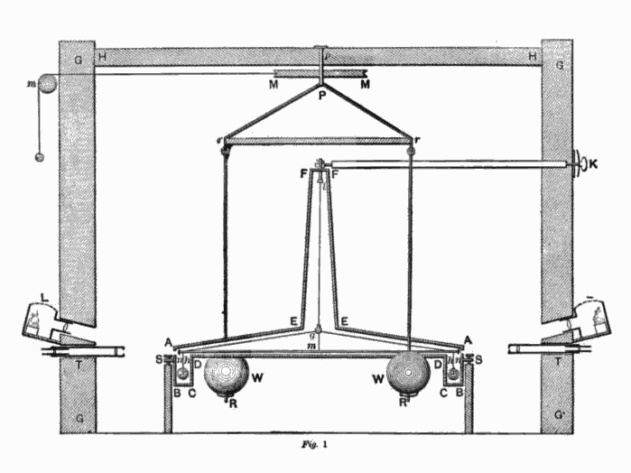{width=70% fig-align="center"}

:::

:::

:::

## Tierra 


::: {.columns}

::: {.column}

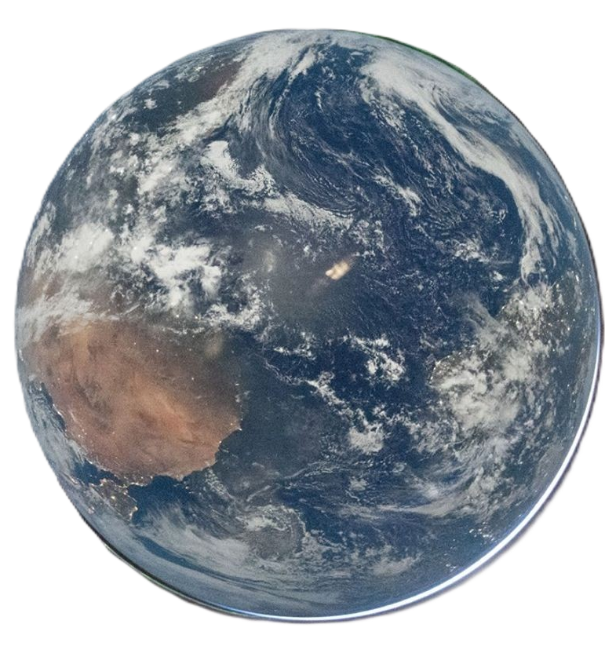{width=80% fig-align="center"}

:::

::: {.column}

Dado a que la Tierra es el cuerpo central de referencia para la mayoría de los satélites artificiales, es importante conocer algunos de sus parámetros. Las cuatro constantes astronómicas más importantes de la Tierra son:

- **Parámetro gravitacional** $\mu_\oplus$:
- **Radio ecuatorial** $R_\oplus$:
- **Velocidad de rotación** $\omega_\oplus$:
- **Excentricidad o achatamiento** $e_\oplus$, $f_\oplus$.

De acuerdo a la IAU, los valores de estas constantes son:

$$
\begin{aligned}
\mu_\oplus &= 3.986 004 415 \times 10^{14} \pm 8 \times 10^{5} \frac{\mathrm{m^3}}{\mathrm{seg^2}}\\
R_\oplus &= 6.378 1366 \times 10^6  \pm 1 \times 10^{-1}\mathrm{m}\\
\omega_\oplus &= 7.292 115 \times 10^{-5} \frac{\mathrm{rad}}{\mathrm{seg}}\\
\end{aligned}
$$

Utilizando los valores nominales de $G$ y $\mu_\oplus$, podemos estimar la masa de la Tierra:

$$
m_\oplus = \frac{\mu_\oplus}{G} \approx 5.972186 \times 10^{24}\ \mathrm{kg}.
$$  

:::

:::

---

::: {.columns}

::: {.column}

<div class="vspace-3"></div>
<div class="vspace-3"></div>

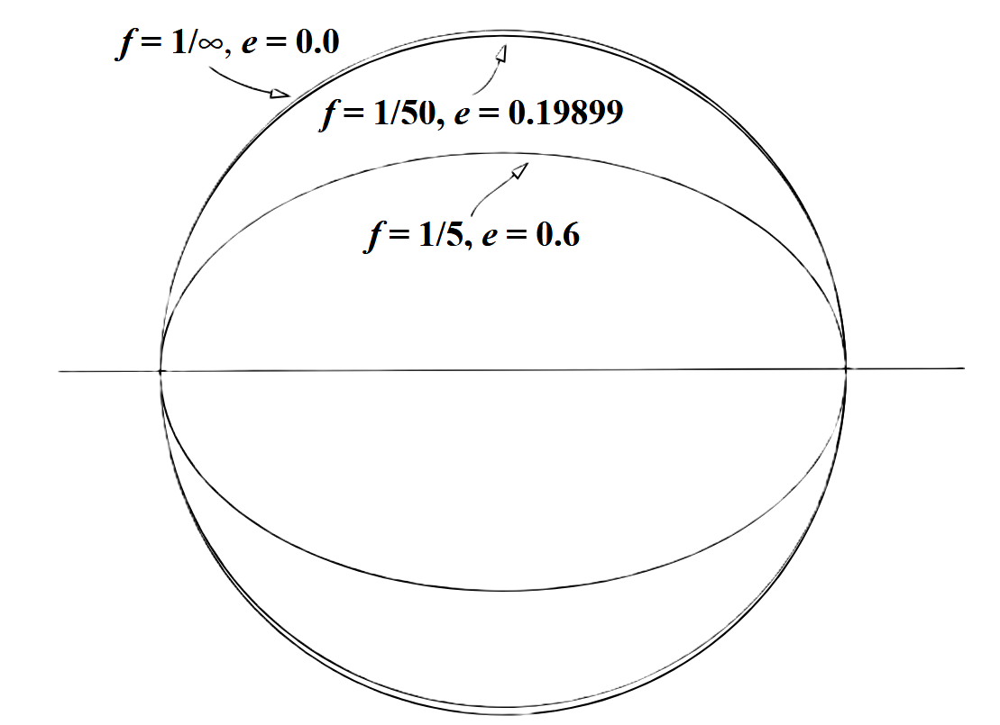{width=100% fig-align="center"}

:::

::: {.column}

- La forma de la Tierra no es perfectamente esférica, sino que presenta un achatamiento en los polos y un ensanchamiento en el ecuador. Esto se debe a la rotación de la Tierra y a la distribución desigual de su masa. 
- Para aproximar la forma de la Tierra, en lugar de utilizar una esfera, se emplea una **elipsoide** (a,b,c).
- En general, una elipsoide es una superficie cerrada cuyas tres secciones ortogonales son elipses. En particular, un elipsoide de revolución es una superficie generada por la rotación de una elipse alrededor de uno de sus ejes principales. A este elipsoide se le conoce como **esferoide**, y puede ser de dos tipos:

  - **Esferoide oblato:** generado por la rotación de una elipse alrededor de su eje menor (a,b,a). 
  - **Esferoide prolato:** generado por la rotación de una elipse alrededor de su eje mayor (a,b,b).

- En el caso de la Tierra, se utiliza un esferoide oblato para aproximar su forma, dado a que el radio polar de la Tierra de acuerdo a la IAU es

  $$
  R_{\oplus,p}= 6.3568 \times 10^6 \mathrm{m}.
  $$


:::

:::

---


::: {.columns}

::: {.column}

<div class="vspace-3"></div>
<div class="vspace-3"></div>

{width=100% fig-align="center"}

:::

::: {.column}

- En dicho caso, la elipse asociada al esferoide oblato tiene un semieje mayor $a=R_{\oplus}$ y un semieje menor $b=R_{\oplus,p}$.

- Tomando los valores nominales podemos calcular la excentricidad de la Tierra:

$$
  e_\oplus = \sqrt{1-\frac{b^2}{a^2}} \approx 0.0817273 .
$$

- Otro parámetro que se utiliza para describir la forma de la Tierra es el achatamiento $f_\oplus$, el cual se define como

$$
f_\oplus = \frac{a-b}{a} \approx 0.003345271 = \frac{1}{298.929379}.
$$  
:::

::: {.callout-note .fragment}
### Nota:

El achatamiento $f$ es un parámetro que se define en general para cualquier elipse. Esto implica que en lugar de utilizar ña excentricidad $e$ para describir la forma de una trayectoria elíptica, también podemos utilizar el achatamiento $f$. Sin embargo, es poco común. 
:::


:::


## Sol


::: {.columns}

::: {.column}

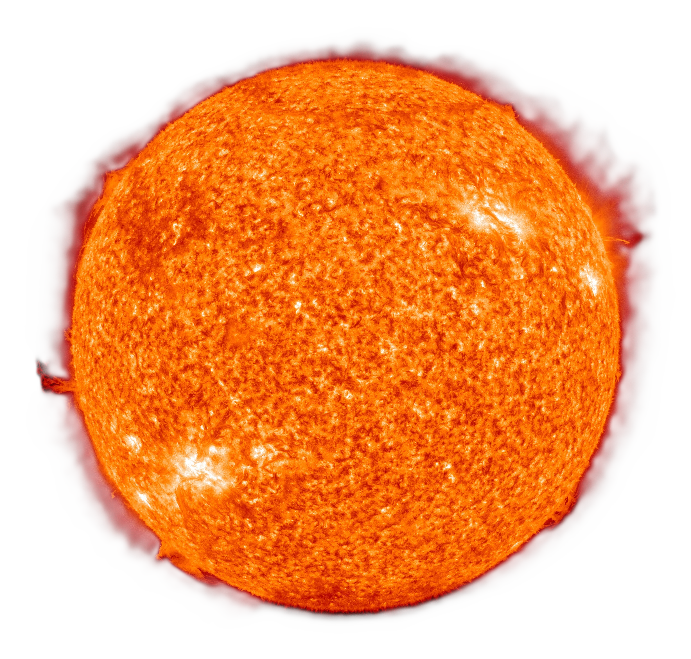{width=93% fig-align="center"}

:::

::: {.column}

Otro astro de interés es el **Sol**, dado a que es el cuerpo central de referencia para la mayoría de los planetas y asteroides del sistema solar. Las constantes astronómicas más importantes del Sol son:

- **Parámetro gravitacional** $\mu_\odot$.
- **Radio** $R_\odot$.
- **Irradancia solar** $E_\odot$.
- **Temperatura solar** $T_\odot$ 
- **Luminosidad solar** $L_\odot$.

De acuerdo a la IAU, los valores de estas constantes son:

$$ 
\begin{aligned}
\mu_\odot & = 1.32712442099 \times 10^{20} \pm 1.0 \times 10^{10} \mathrm{m}^3 \mathrm{seg}^{-2}, \\
R_\odot & = 6.957 \times 10^8 \mathrm{m}, \\
E_\odot & = 1361  \mathrm{W/m^2}, \\
T_\odot & = 5772 \mathrm{K}, \\
L_\odot & = 3.828 \times 10^{26} \mathrm{W}.
\end{aligned}
$$

Utilizando los valores nominales de $G$ y $\mu_\odot$, podemos estimar la masa del Sol:

$$
m_\odot = \frac{\mu_\odot}{G} \approx 1.988415861 \times 10^{30}\ \mathrm{kg}.
$$


:::

:::


## Luna 


::: {.columns}

::: {.column}

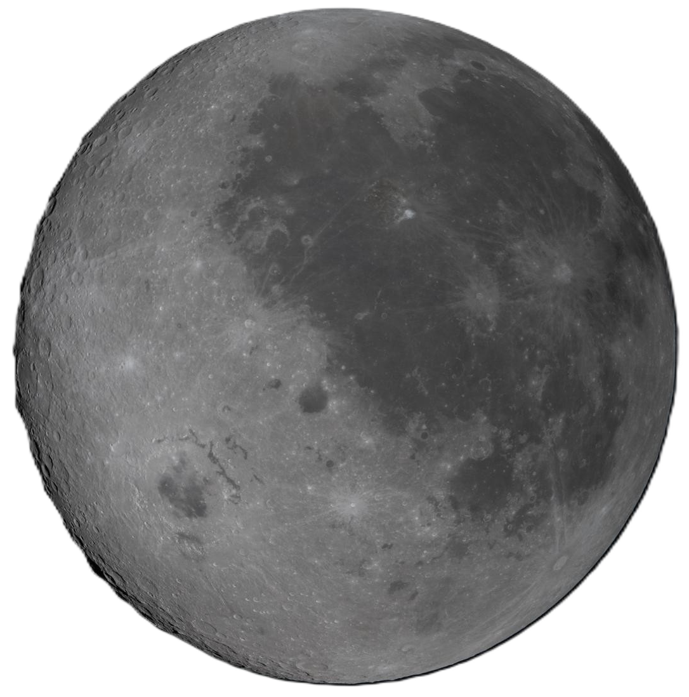{width=78% fig-align="center"}

:::

::: {.column}

La **Luna** es el satélite natural de la Tierra y es el cuerpo celeste más cercano a nuestro planeta.  La IAU sólo reporta la relación entre la masa de la Luna y la masa de la Tierra:

$$
  \frac{m_{☾}}{m_{\oplus}} \approx 1.230 003 71 \times 10^{-2}.
$$

Utilizando $m_\oplus$, podemos estimar la masa de la Luna:

$$
m_{☾}= 1.230 003 71 \times 10^{-2} m_{\oplus} \approx 7.346010 \times 10^{22}\ \mathrm{kg}.
$$

- Al igual que la Tierra, la Luna no es perfectamente esférica, pero por cuestiones prácticas se puede considerar como tal (véase [JPL](https://ssd.jpl.nasa.gov/doc/lunar_cmd_2005_jpl_d32296.pdf)). Es decir, $f_☾ \approx 0$. 


- Tomando al [JPL](https://ssd.jpl.nasa.gov/doc/lunar_cmd_2005_jpl_d32296.pdf) como referencia, la Luna tiene los siguientes parámetros:  

$$
\begin{aligned}
R_{☾} & = 1.738 \times 10^6 \mathrm{m}, \\
\omega_{☾} & = 2.6617 \times 10^{-6} \mathrm{rad/seg}, \\
\end{aligned}
$$


:::

:::

<div class="vspace-3"></div>
<div class="vspace-3"></div>

## Constante gravitacional gaussiana

En 1809, **Carl Friedrich Gauss** determinó una constante gravitacional para describir el movimiento orbital en el sistema solar. La IAU adoptó su valor para el Sol en 1939 para poder calcular posteriormente los parámetros gravitacionales de otros cuerpos .

La constante se define como

$$
\boxed{k_{\odot}=\sqrt{Gm_{\odot}} \approx 0.017\,202\,098\,95}
$$


::: {.fragment}

Dado a los avances tecnológicos de la época( los cuales ayudaron a estimar directamente $\mu_\odot$), la IAU, en su resolución del 2012 decidió retirar esta constante de las constantes astronómicas definitorias. En su lugar, incluyeron la definición de la **unidad astronómica**.


$$
\boxed{1 \mathrm{AU} = 149597870700 \mathrm{m},}
$$

la cual corresponde a la distancia media entre la Tierra y el Sol. 

:::


::: {.callout-note .fragment}
### Nota:

Existen más constantes astronómicas que vamos a utilizar, pero se irán introduciendo conforme a los temas. 


:::

---

::: {.center-vertical}

::: {.chapter-title}

Aplicación 

:::

<div class="chapter-line"></div>

::: {.chapter-subtitle}

Parámetros de localización

<div class="menu-title" style="display:none;"> ▸ Parámetros de localización</div>
:::

:::


## Parámetros de localización

Los parámetros de localización permiten describir la posición de un punto sobre la superficie terrestre.


::: {.columns}

:::: {.column width="45%"}

Se definen dos parámetros terrestres:

- **Latitud geográfica**, $\phi$.
- **Longitud geográfica**, $\lambda$.

  Ambos son coordenadas angulares que se utilizan para localizar puntos sobre la superficie terrestre.

- Un **meridiano** es la intersección de un plano que contiene el eje de rotación terrestre con la superficie de la Tierra.

- La intersección del **eje de rotación terrestre** y la superficie de la Tierra define los **polos norte y sur**, donde el norte corresponde a la regla de la mano derecha.

- El **ecuador** es el conjunto de puntos de la superficie terrestre situados en el plano perpendicular al eje de rotación que pasa por el centro de masa de la Tierra,

- El **plano ecuatorial** contiene el ecuador y sirve como referencia para la localización.  

:::
::: {.column width="55%"}

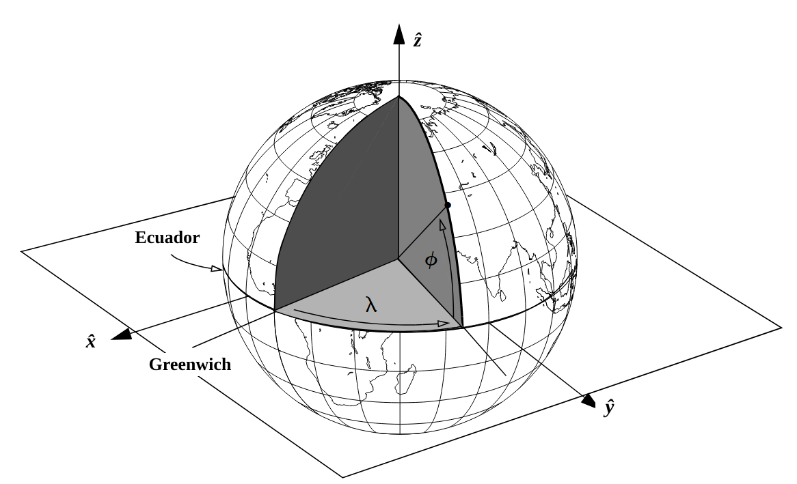{width=100% fig-align="center"}

::::
:::


## Parámetros de localización

- La **longitud geográfica**, $\lambda$, es el desplazamiento angular este-oeste medido desde un meridiano de referencia (tambien llamado meridiano primario).

::: {.columns}

:::: {.column width="45%"}


- 
- El **meridiano de Greenwich** es el meridiano de referencia y define:

  $$
  \lambda=0^\circ.
  $$

  Dicho nombre se deriva de que el meridiano pasa por el Real Observatorio de Greenwich, en Londres.

- Por convención, la longitud positiva se mide hacia el este. Esta convención fue acordada en la Conferencia Internacional del Meridiano, celebrada en Washington D. C. en 1884.

- La longitud puede expresarse en dos intervalos:

$$
0^\circ \leq \lambda < 360^\circ
$$

o

$$
-180^\circ \leq \lambda \leq 180^\circ
$$

:::

::: {.column width="55%"}

{width=120% fig-align="center"}

::::
:::


## Parámetros de localización

- La **latitud geográfica**, $\phi$, es la coordenada angular norte-sur medida desde plano de referencia. 

::: {.columns}

:::: {.column width="45%"}


- El **plano ecuatorial** es el plano de referencia para medir la latitud, y define 

$$
\phi=0^\circ
$$

- La latitud tiene como intervalo:

$$
-90^\circ \leq \phi \leq 90^\circ
$$

donde: 

  - Hemisferio norte: $\phi>0^\circ$.
  - Hemisferio sur: $\phi<0^\circ$.
  - Polo norte: $\phi=90^\circ$.
  - Polo sur: $\phi=-90^\circ$.

:::

::: {.column width="55%"}

{width=120% fig-align="center"}

::::
:::

## Latitud geocéntrica y geodésica


::: {.columns}

:::: {.column width="45%"}

<div class="vspace-3"></div>

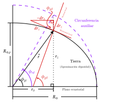{width=120% fig-align="center"}

:::

::: {.column width="55%"}


- La **elipsoide de referencia** es una aproximación geométrica de la superficie terrestre. No obstante, la superficie real de la Tierra no asemeja al relieve de la elipsoide.

- La superficie real de la Tierra a nivel medio del mar, excluyendo pequeños efectos atmosféricos y de marea, se denomina **geoide**.

- Se define como una **superficie equipotencial del campo gravitatorio terrestre**: el potencial gravitatorio es constante en todos sus puntos.

Por esta propiedad, la dirección de la gravedad es perpendicular al geoide en cada punto. Esto nos permite clasificar la latitud en dos categorías:

- La **latitud geocéntrica**, $\phi_{gc}$, es el ángulo medido desde el centro de la Tierra entre: 

  - El plano ecuatorial. 
  - El vector que une el centro terrestre con el punto de interés. 

- La **latitud geodésica**, $\phi_{gd}$, es el ángulo entre:

  - El plano ecuatorial.
  - La normal (también llamada horizontal local) al elipsoide de referencia en el punto de interés, a nivel del mar.

  Esta latitud se utiliza habitualmente para mapas, sistemas de navegación y receptores GPS.

:::
:::

---

::: {.columns}

:::: {.column width="45%"}

<div class="vspace-3"></div>

{width=120% fig-align="center"}

:::

::: {.column width="55%"}


- Dado al achatamiento del elipsoide de referencia, la latitud geocéntrica y geodésica suelen ser cercanas. Sin embargo, la diferencia puede ser significativa cuando necesitamos caracterizar un punto en la superficie terrestre.

- Para encontrar una relación entre ellas, considere que el vector de posición $\vec{r}$ puede expresarse en coordenadas geocentricas (esféricas) como:


  $$
  \vec{r} = r
  \begin{bmatrix}
  \cos(\phi_{gc})\cos(\lambda) \\
  \cos(\phi_{gc})\sin(\lambda) \\
  \sin(\phi_{gc})
  \end{bmatrix}
  $$

- Dado que únicamente nos interesa la relación entre $\phi_{gc}$ y $\phi_{gd}$, vamos a definir las componentes horizontales (contenidas en el plano ecuatorial) y verticales (normal al plano ecuatorial).

  Las componentes son

  $$
  r_\delta = \sqrt{r_x^2 + r_y^2} = r\cos(\phi_{gc})
  $$

  $$
  r_z = r\sin(\phi_{gc})
  $$

:::
:::

---

::: {.columns}

:::: {.column width="45%"}

<div class="vspace-3"></div>

{width=120% fig-align="center"}

:::

::: {.column width="55%"}

- Ahora, similar a lo que hicimos para encontrar la anomalía excéntrica, podemos relacionar $\phi_{gc}$ y $\phi_{gd}$, que es el ángulo entre el plano ecuatorial y la proyección de la posición en una esfera de radio $R_\oplus$.

  $$
  r_\delta = R_\oplus \cos(\phi_{gd}) = r\cos(\phi_{gc})
  $$

  $$
  r_z = r\sin(\phi_{gc}) = R_\oplus\sqrt{1-e_\oplus^2}\sin(\phi_{gd})
  $$

- Con ello, la magnitud del vector de posición es

  $$
  \begin{aligned}
  r &= \sqrt{r_\delta^2+r_z^2} \\
  &= R_\oplus\sqrt{\cos^2(\phi_{gd})+(1-e_\oplus^2)\sin^2(\phi_{gd})} \\
  &= R_\oplus\sqrt{1-e_\oplus^2\sin^2(\phi_{gd})}
  \end{aligned}
  $$

- La latitud geodésica depende explícitamente de la tangente de la posición $\vec{r}$. Podemos aproximarla utilizando las derivadas de $r_\delta$ y $r_z$ respecto a $\phi_{gd}$.

  $$
  dr_\delta = -R_\oplus\sin(\phi_{gd})\,d\phi_{gd}
  $$

  $$
  dr_z = R_\oplus\sqrt{1-e_\oplus^2}\cos(\phi_{gd})\,d\phi_{gd}
  $$


:::
:::

---

::: {.columns}

:::: {.column width="45%"}

<div class="vspace-3"></div>

{width=120% fig-align="center"}

:::

::: {.column width="55%"}

- Estas componentes forman un triángulo rectángulo, cuya hipotenusa es

  $$
  \begin{aligned}
  dr &= \sqrt{dr_\delta^2+dr_z^2} \\
  &= R_\oplus\sqrt{\sin^2(\phi_{gd})+(1-e_\oplus^2)\cos^2(\phi_{gd})}\,d\phi_{gd} \\
  &= R_\oplus\sqrt{1-e_\oplus^2\cos^2(\phi_{gd})}\,d\phi_{gd}
  \end{aligned}
  $$

- Con ello, podemos relacionar $\phi_{gd}$ y $\phi_{rd}$ mediante funciones trigonométricas.

  $$
  \sin(\phi_{gd}) = -\frac{dr_\delta}{dr_s} = \frac{\sin(\phi_{rd})}{\sqrt{1-e_\oplus^2\cos^2(\phi_{rd})}}
  $$

  $$
  \cos(\phi_{gd}) = \frac{dr_z}{dr_s} = \frac{\sqrt{1-e_\oplus^2}\cos(\phi_{rd})}{\sqrt{1-e_\oplus^2\cos^2(\phi_{rd})}}
  $$


:::
:::


---

::: {.columns}

:::: {.column width="45%"}

<div class="vspace-3"></div>

{width=120% fig-align="center"}

:::

::: {.column width="55%"}

- Para simplificar, considere

  $$
  (1-e_\oplus^2)\sin^2(\phi_{gd}) = \frac{(1-e_\oplus^2)\sin^2(\phi_{rd})}{1-e_\oplus^2\cos^2(\phi_{rd})}
  $$

  $$
  \cos^2(\phi_{gd}) = \frac{(1-e_\oplus^2)\cos^2(\phi_{rd})}{1-e_\oplus^2\cos^2(\phi_{rd})}
  $$

  Sumando ambas expresiones tenemos

  $$
  (1-e_\oplus^2)\sin^2(\phi_{gd})+\cos^2(\phi_{gd}) = 1-e_\oplus^2\sin^2(\phi_{gd})
  $$

  $$
  = \frac{1-e_\oplus^2}{1-e_\oplus^2\cos^2(\phi_{rd})}
  $$

  Por lo tanto,

  $$
  1-e_\oplus^2\cos^2(\phi_{rd}) = \frac{1-e_\oplus^2}{1-e_\oplus^2\sin^2(\phi_{gd})}
  $$

:::
:::


---

::: {.columns}

:::: {.column width="45%"}

<div class="vspace-3"></div>

{width=120% fig-align="center"}

:::

::: {.column width="55%"}

- Mediante lo anterior, podemos obtener

  $$
  \sin(\phi_{rd}) = \frac{\sqrt{1-e_\oplus^2}}{\sqrt{1-e_\oplus^2\sin^2(\phi_{gd})}}\sin(\phi_{gd})
  $$

  $$
  \cos(\phi_{rd}) = \frac{1}{\sqrt{1-e_\oplus^2\sin^2(\phi_{gd})}}\cos(\phi_{gd})
  $$

- Finalmente, sustituyendo en las componentes $r_\delta$ y $r_z$ tenemos

  $$
  r_\delta = \frac{R_\oplus}{\sqrt{1-e_\oplus^2\sin^2(\phi_{gd})}}\cos(\phi_{gd})
  $$

  $$
  r_z = \frac{R_\oplus(1-e_\oplus^2)}{\sqrt{1-e_\oplus^2\sin^2(\phi_{gd})}}\sin(\phi_{gd})
  $$

- **Estas fórmulas son exactas para una superficie perfectamente elipsoidal. No obstante, la superficie de la Tierra genera variaciones respecto a la elipsoide de referencia**. 

:::
:::


---

::: {.columns}

:::: {.column width="45%"}

<div class="vspace-3"></div>

{width=120% fig-align="center"}

:::

::: {.column width="55%"}

- Para proyectar la latitud geodésica a la altura real del objeto:

  $$
  C_\oplus = \frac{R_\oplus}{\sqrt{1-e_\oplus^2\sin^2(\phi_{gd})}}
  $$

  $$
  S_\oplus = \frac{R_\oplus(1-e_\oplus^2)}{\sqrt{1-e_\oplus^2\sin^2(\phi_{gd})}}
  $$

  y

  $$
  r_\delta = (C_\oplus + h_{ellip})\cos(\phi_{gd})
  $$

  $$
  r_z = (S_\oplus + h_{ellip})\sin(\phi_{gd})
  $$

  $$
  r = \sqrt{r_\delta^2+r_z^2}
  $$

  donde $h_{ellip}$ es la altura sobre el elipsoide de referencia. 
  
- **Mediante esta formulación, podemos proyectar la latitud geodésica a cualquier altura sobre el elipsoide de referencia.**


:::
:::

---

::: {.columns}

:::: {.column width="45%"}

<div class="vspace-3"></div>

{width=120% fig-align="center"}

:::

::: {.column width="55%"}

- Entonces

  $$
  r_\delta = r\cos(\phi_{gc}) = (C_\oplus+h_{ellip})\cos(\phi_{gd})
  $$

  $$
  r_z = r\sin(\phi_{gc}) = (S_\oplus+h_{ellip})\sin(\phi_{gd})
  $$

- Con ello

  $$
  \boxed{
  \vec{r} = r
  \begin{bmatrix}
  \cos(\phi_{gc})\cos(\lambda) \\
  \cos(\phi_{gc})\sin(\lambda) \\
  \sin(\phi_{gc})
  \end{bmatrix}
  =
  \begin{bmatrix}
  (C_\oplus+h_{ellip})\cos(\phi_{gd})\cos(\lambda) \\
  (C_\oplus+h_{ellip})\cos(\phi_{gd})\sin(\lambda) \\
  (S_\oplus+h_{ellip})\sin(\phi_{gd})
  \end{bmatrix}
  }
  $$

- Ahora, para pasar de coordenadas cartesianas a coordenadas geodésicas

  $$
  \vec{r} =
  \begin{bmatrix}
  r_x \\
  r_y \\
  r_z
  \end{bmatrix}
  =
  \begin{bmatrix}
  (C_\oplus+h_{ellip})\cos(\phi_{gd})\cos(\lambda) \\
  (C_\oplus+h_{ellip})\cos(\phi_{gd})\sin(\lambda) \\
  (S_\oplus+h_{ellip})\sin(\phi_{gd})
  \end{bmatrix}
  $$

- Para la longitud $\lambda$,

  $$
  \tan(\lambda)=\frac{r_y}{r_x}
  $$

  $$
  \boxed{
  \lambda = \operatorname{atan2}(r_y,r_x)
  }
  $$


:::
:::

---

::: {.columns}

:::: {.column width="45%"}

<div class="vspace-3"></div>

{width=120% fig-align="center"}

:::

::: {.column width="55%"}


- Para $\phi_{gd}$,

$$
r_\delta = (C_\oplus+h_{ellip})\cos(\phi_{gd})
$$

$$
r_z = (S_\oplus+h_{ellip})\sin(\phi_{gd})
$$

Por lo tanto,

$$
\cos(\phi_{gd}) = \frac{r_\delta}{C_\oplus+h_{ellip}}
$$

$$
\sin(\phi_{gd}) = \frac{r_z}{S_\oplus+h_{ellip}}
$$

de donde podemos despejar $h_{ellip}$,

$$
\boxed{
\begin{aligned}
h_{ellip} &= \frac{r_\delta}{\cos(\phi_{gd})}-C_\oplus\\
h_{ellip} &= \frac{r_z}{\sin(\phi_{gd})}-S_\oplus\\
\end{aligned}
}
$$

:::
:::

---

::: {.columns}

:::: {.column width="45%"}

<div class="vspace-3"></div>

{width=120% fig-align="center"}

:::

::: {.column width="55%"}

- Entonces,

  $$
  \begin{split}
  \tan(\phi_{gd}) &= \frac{\sin(\phi_{gd})}{\cos(\phi_{gd})},\\
  &= \frac{r_z\left(C_\oplus+\dfrac{r_z}{\sin(\phi_{gd})}-S_\oplus\right)}{r_\delta\left(S_\oplus+\dfrac{r_z}{\sin(\phi_{gd})}-S_\oplus\right)},\\
  &= \frac{1}{r_\delta}\left((C_\oplus-S_\oplus)\sin(\phi_{gd})+r_z\right)
  \end{split}
  $$

- Si

  $$
  C_\oplus = \frac{S_\oplus}{1-e_\oplus^2}
  $$

  Por lo tanto,

  $$
  \boxed{
  \tan(\phi_{gd}) = \frac{1}{r_\delta}\left(e_\oplus^2 C_\oplus\sin(\phi_{gd})+r_z\right)
  }
  $$

- **Si bien esta ecuación es implícita, podemos resolverla mediante un método iterativo**. 

:::
:::

---

::: {.algorithm}

<div class="algorithm-title">Algoritmo 3.1: Conversión $\vec{r}$ a coordenadas geodésicas</div>

<div class="algorithm-io">
<strong>Entrada:</strong> $\vec{r}=[r_x,r_y,r_z]^T$, $R_\oplus$, $e_\oplus$, $\varepsilon$.

<strong>Salida:</strong> $\lambda,\phi_{gd},h_{ellip}$.
</div>

:::{.small}

1. Calcular la componente horizontal: $r_\delta = \sqrt{r_x^2+r_y^2}$

2. Calcular la longitud $\lambda = \operatorname{atan2}(r_y,r_x)$

3. Calcular la estimación inicial de la latitud geodésica: $\bar{\phi}_0 = \operatorname{atan2}(r_z,r_\delta)$

4. Iterar hasta alcanzar la convergencia:

$$
C_\oplus = \frac{R_\oplus}{\sqrt{1-e_\oplus^2\sin^2(\bar{\phi}_{n-1})}}
$$

$$
\bar{\phi}_n = \operatorname{atan2}\left(r_z+e_\oplus^2 C_\oplus\sin(\bar{\phi}_{n-1}),r_\delta\right)
$$


  hasta que $|\bar{\phi}_n-\bar{\phi}_{n-1}| < \varepsilon$

5. Asignar la latitud geodésica: $\phi_{gd} = \bar{\phi}_n$

6. Calcular la altura elipsoidal:

$$
h_{ellip} = \begin{cases}
\frac{r_\delta}{\cos(\phi_{gd})}-C_\oplus, & \text{si } |\phi_{gd}| < 90^\circ\\[0.5em]
\frac{r_z}{\sin(\phi_{gd})}-S_\oplus, & \text{si } |\phi_{gd}| \geq 90^\circ
\end{cases}
$$

:::

:::


---

::: {.algorithm}

<div class="algorithm-title">Algoritmo 3.2: Conversión ECEF a coordenadas geodésicas</div>

<div class="algorithm-io">
<strong>Entrada:</strong> $\lambda,\phi_{gd},h_{ellip}$, $R_\oplus$, $e_\oplus$.

<strong>Salida:</strong> $\{\vec{r}\}$.
</div>

:::{.small}

1. Calcular 

$$
C_\oplus = \frac{R_\oplus}{\sqrt{1-e_\oplus^2\sin^2(\phi_{gd})}}, \qquad S_\oplus = \frac{R_\oplus(1-e_\oplus^2)}{\sqrt{1-e_\oplus^2\sin^2(\phi_{gd})}}
$$

2. Calcular el vector de posición:

$$
\vec{r} = 
  \begin{bmatrix}
  (C_\oplus+h_{ellip})\cos(\phi_{gd})\cos(\lambda) \\
  (C_\oplus+h_{ellip})\cos(\phi_{gd})\sin(\lambda) \\
  (S_\oplus+h_{ellip})\sin(\phi_{gd})
  \end{bmatrix}
$$

:::

:::


- Si bien estos algoritmos nos permiten convertir entre coordenadas geodésicas y coordenadas cartesianas, es importante mencionar que la superficie de la Tierra no es perfectamente elipsoidal. Por lo tanto, para aplicaciones de alta precisión, se deben considerar modelos más complejos del geoide y las variaciones locales del campo gravitatorio. Esto se aborda mediante el concepto de **ondulación geoidal**, que representa las desviaciones del geoide respecto a la elipsoide de referencia,  y **superficies equipotenciales**.  

- Un detalle importante es que hemos hablado de un vector de posición $\vec{r}$, pero no hemos definido un marco de referencia sobre el cual están definidas sus componentes.


---

::: {.center-vertical}

::: {.chapter-title}

Aplicación 

:::

<div class="chapter-line"></div>

::: {.chapter-subtitle}

Sistemas de referencia terrestre

<div class="menu-title" style="display:none;"> ▸ 
Sistemas de referencia terrestre </div>
:::

:::

## Sistemas de referencia

Un sistema de referencia establece las convenciones necesarias para describir la posición y evolución temporal de los fenómenos físicos.

Su definición requiere especificar:

- **Origen:** punto respecto al cual se describen las posiciones.
- **Orientación (base ortonormal):** direcciones que definen los ejes coordenados.
- **Referencia temporal:** escala de tiempo utilizada para asignar coordenadas temporales a los eventos.

Un evento puede representarse mediante cuatro coordenadas:

$$
\mathcal{P} = (t,x,y,z)
$$

::: {.columns}

::: {.column width="33%"}

**Geocéntrico (Heliocéntrico)**

Origen en el centro de masa de la Tierra (Sol).

$$
\vec{r}_{O} = \vec{0}
$$

Se utiliza para describir el movimiento de satélites terrestres (en el sistema solar).

:::

::: {.column width="33%"}
**Topocéntrico**

Origen en un punto sobre la superficie terrestre.

$$
\vec{r}_{O} = \vec{0}
$$

Se utiliza en observaciones desde estaciones terrestres.
:::

::: {.column width="33%"}
**Baricéntrico**

Origen en el centro de masa de un sistema de cuerpos.

$$
\sum_i m_i\vec{r}_i = \vec{0}
$$

Se utiliza en el estudio de sistemas de varios cuerpos.
:::
:::
::: {.callout-note}
Un sistema **sinódico** es un sistema de coordenadas rotatorio asociado al baricentro, particularmente útil en el problema de más de dos cuerpos. Esto se estudiará cuando hablemos de perturbaciones. 
:::

## Sistemas y marcos de referencia

Un sistema de referencia establece las convenciones matemáticas y físicas necesarias para describir la posición y el movimiento de los cuerpos.

Un marco de referencia es la realización física de ese sistema mediante objetos, estaciones o puntos de referencia cuyas posiciones se conocen.

\vspace{0.3cm}

**Sistema de referencia**

- Define el origen del sistema de coordenadas.
- Establece la orientación de los ejes.
- Define las convenciones y modelos necesarios para describir su evolución.
- Es una definición conceptual y matemática.

\vspace{0.3cm}

**Marco de referencia**

- Materializa el sistema mediante puntos u objetos de referencia.
- Asigna coordenadas a dichos puntos.
- Se obtiene mediante observaciones y procedimientos de estimación.
- Permite expresar posiciones y realizar mediciones concretas.

\vspace{0.3cm}

::: {.callout-note}
**Ejemplo:**

El ITRS (*International Terrestrial Reference System*) define el sistema de referencia terrestre convencional.

El ITRF (*International Terrestrial Reference Frame*) es su realización mediante las coordenadas de estaciones terrestres obtenidas a partir de observaciones geodésicas.
:::

## Esfera celeste

::: {.columns}

:::: {.column width="45%"}

<div class="vspace-3"></div>

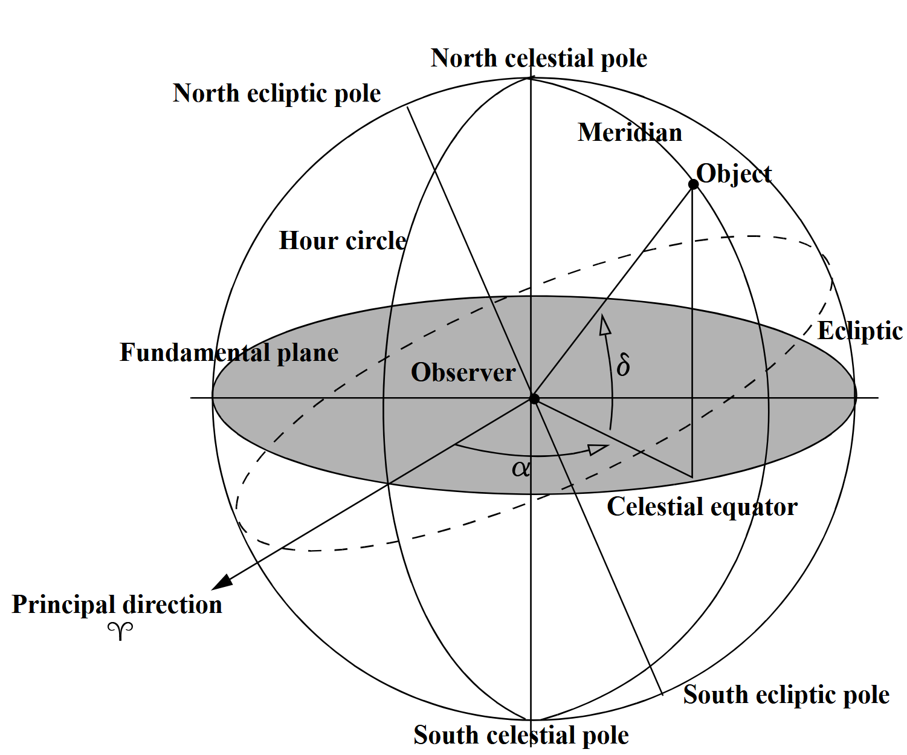{width=110% fig-align="center"}


::: {.callout-note title="Cenit y nadir"}
El **cenit** es la dirección vertical que apunta desde un observador hacia el punto de la esfera celeste situado directamente sobre él.
El **nadir** es la dirección opuesta, que apunta directamente debajo del observador.
Ambas direcciones se encuentran sobre la **vertical local**.

:::

:::

::: {.column width="55%"}


La esfera celeste es una representación geométrica imaginaria en la que se proyectan las posiciones aparentes de los cuerpos celestes. Se considera una esfera de radio arbitrario, cuyo centro puede situarse en el observador o en el origen de un sistema de referencia.

- **Polos celestes:** intersecciones del eje de rotación terrestre con la esfera celeste.
- **Ecuador celeste:** proyección del plano ecuatorial terrestre sobre la esfera celeste. También llamado plano fundamental.
- **Círculos horarios:** circunferencias máximas que pasan por ambos polos celestes.
- **Meridiano celeste:** círculo horario que contiene al cenit del observador.
- **Punto de referencia:** punto sobre la esfera celeste que representa el origen del sistema de coordenadas.
- **Ascensión recta ($\alpha$):** ángulo medido desde el punto de referenia hasta la proyección del objeto sobre el ecuador celeste, siguiendo la dirección de rotación de la Tierra.
- **Declinación ($\delta$):** angulo medido desde el plano fundamentel hasta la proyección del objeto sobre la esfera celeste.


:::
:::


## Esfera celeste

::: {.columns}

:::: {.column width="45%"}

<div class="vspace-3"></div>

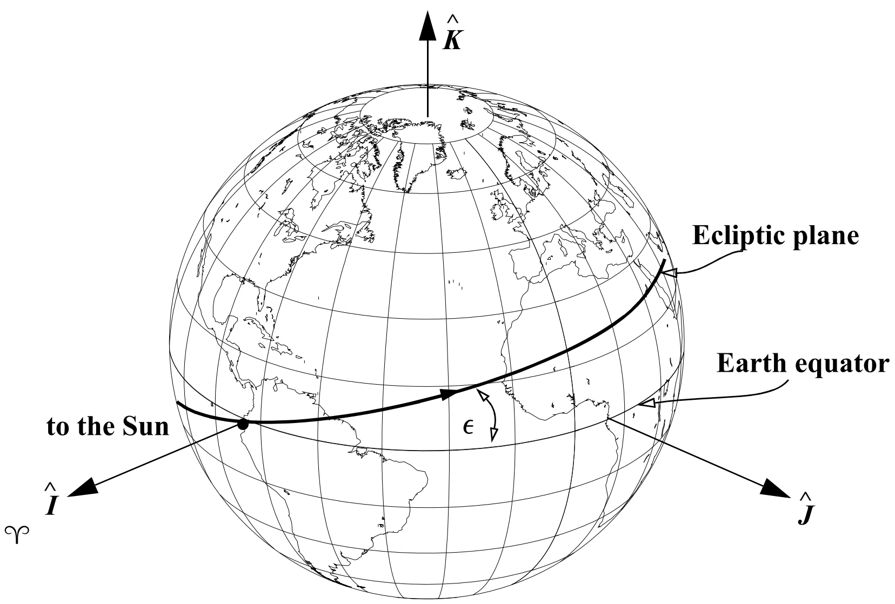{width=120% fig-align="center"}

:::

::: {.column width="55%"}


La eclíptica representa el plano de la órbita media de la Tierra alrededor del Sol. Su inclinación respecto al plano ecuatorial terrestre es aproximadamente $\epsilon=23.4^\circ$. La intersección entre la ecliptica y el plano ecuatorial celeste define una línea de nodos, cuyos extremos corresponden a los equinoccios.

- **Equinoccio de primavera:** el Sol cruza el ecuador celeste de sur a norte (hemisferio norte).
- **Equinoccio de otoño:** el Sol cruza el ecuador celeste de norte a sur (hemisferio norte).

\vspace{0.3cm}

**Punto vernal (equinoccio vernal)** (♈︎)

Es la dirección del equinoccio de primavera. Se utiliza como dirección de referencia para medir la ascensión recta en el sistema de coordenadas celeste.

\vspace{0.3cm}

::: {.callout-note}

Históricamente, el punto vernal se denominó punto de Aries porque hace aproximadamente dos mil años coincidía con la constelación de Aries (época cristiana). Debido a la precesión terrestre, actualmente se encuentra en la dirección de Piscis.

Se utiliza como origen de la ascensión recta ($\alpha = 0$).

:::

:::
:::


## Sistemas de referencia geocéntricos

Los sistemas geocéntricos utilizan el centro de masa de la Tierra como origen. Según la orientación y el movimiento de sus ejes, se distinguen dos categorías:

**ECI — Earth-Centered Inertial**

- Origen en el centro de masa de la Tierra.
- Ejes con orientación aproximadamente fija respecto al espacio inercial.
- No gira con la Tierra.
- Se utiliza para describir el movimiento orbital de satélites.

**ECEF — Earth-Centered, Earth-Fixed**

- Origen en el centro de masa de la Tierra.
- Ejes fijos a la rotación terrestre.
- Gira junto con la Tierra.
- Se utiliza para describir posiciones sobre la superficie terrestre.


## Sistema de referencia terrestre internacional (ITRS)

El **ITRS** (*International Terrestrial Reference System*) define un sistema ECEF, cuya orientación está vinculada a la Tierra. <span style="color:red"> Es el marco sobre el cual obtenemos coordenadas geodésicas y se utiliza para describir posiciones sobre la superficie terrestre. </span>


::: {.columns}

::: {.column}

**Definición del sistema:**

- **Origen:** centro de masa del sistema Tierra.
- **Eje $z$:** orientado hacia el polo norte terrestre.
- **Eje $x$:** contenido en el plano ecuatorial y orientado según el meridiano de Greenwich.
- **Eje $y$:** completa la regla de la mano derecha.


:::

::: {.column}


:::

:::

**Realización del sistema:**

El **ITRF** (*International Terrestrial Reference Frame*) materializa el ITRS mediante coordenadas y velocidades de estaciones geodésicas distribuidas alrededor del planeta.

- Sus coordenadas se determinan mediante técnicas de geodesia.
- Incorpora la evolución temporal de las posiciones de las estaciones.

## Sistema de referencia celeste geocéntrico (GCRS)

El **GCRS** (*Geocentric Celestial Reference System*) es un sistema de referencia relativista definido por la IAU, cuyo origen se encuentra en el centro de masa de la Tierra. Es el marco de referencia ECI más utilizado.

**Características del sistema:**

- **Origen:** centro de masa de la Tierra.
- **Orientación:** ejes cinemáticamente no rotantes respecto al sistema celeste baricéntrico (BCRS).
- **Naturaleza:** sistema geocéntrico cuasi-inercial.
- **Aplicación:** descripción de posiciones y movimientos de satélites y otros cuerpos cercanos a la Tierra.

**Realización del sistema:**

El **GCRF** (*Geocentric Celestial Reference Frame*) es la realización práctica del GCRS. Su orientación se establece mediante una relación con el sistema celeste internacional (ICRS).

::: {.callout-note .fragment}
### Nota:

La tranformación entre el GCRF y el ITRF se realiza mediante una serie de rotaciones que consideran la precesión, nutación, rotación de la Tierra y polar motion. La descripción detallada de estas transformaciones se apoya de modelos numéricos, lo cual no es algo que no se abordará en esta etapa del curso. Sin embargo, es importante conocer que estas transformaciones existen y son necesarias para convertir coordenadas entre sistemas de referencia geocéntricos.

:::


## Marco inercial geocéntrico $\ls{i}{\mathcal{F}}$

Debido a la complejidad de la transformación entre el GCRF y el ITRF, vamos a definir el marco inercial geocéntrico $\ls{i}{\mathcal{F}}

::: {.columns}

::: {.column}

**Centro:** $\ls{i}{O}$ (centro de la Tierra).

**Ejes:**

- $\ls{i}{\vec{x}}$: apunta al equinoccio vernal.
- $\ls{i}{\vec{y}}$: completa la regla de la mano derecha.
- $\ls{i}{\vec{z}}$: apunta al eje de rotación terrestre.

- El adjetivo **inercial** indica que es un marco de referencia **no acelerado** (velocidad constante). 
- Este marco no está establecido por algún sistema de referencia, sino que es un marco de referencia **ideal**, el cual nos va a permitir desarrollar las bases los conceptos de la clase.
:::

::: {.column}

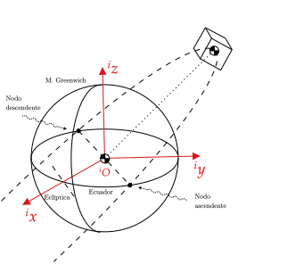{width=100% fig-align="center"}

:::

:::

---

::: {.center-vertical}

::: {.chapter-title}

Aplicación 

:::

<div class="chapter-line"></div>

::: {.chapter-subtitle}

Tiempo

<div class="menu-title" style="display:none;"> ▸ Tiempo </div>
:::

:::


## Tiempo

<div class="vspace-3"></div>

:::{.definition-block}

**Definición:**

Magnitud física que permite ordenar la secuencia de los sucesos, estableciendo un pasado, un presente y un futuro, y cuya unidad en el sistema internacional es el segundo.

:::

<div class="vspace-3"></div>

*El propósito fundamental del tiempo es definir con precisión el momento en que ocurre un fenómeno*.

Para describir los acontecimientos necesitamos distinguir tres conceptos:

- **Época:** instante particular en el que ocurre un acontecimiento.
- **Fecha:** representación de una época mediante un sistema de calendario.
- **Escala:** conjunto de convenciones que permiten asignar coordenadas temporales a los acontecimientos.
- **Intervalo:** duración transcurrida entre dos épocas.

Una vez establecida una época de referencia, podemos determinar otras
épocas contabilizando los intervalos transcurridos desde ella.

$$
\Delta t = t_2-t_1
$$

En astrodinámica, el tiempo es especialmente importante porque permite
describir la evolución de los sistemas orbitales y establecer una
referencia temporal precisa y reproducible.


## Sistemas de tiempo

<div class="vspace-3"></div>

Para describir fenómenos astronómicos necesitamos sistemas de tiempo
basados en fenómenos físicos que puedan medirse de manera precisa y
reproducible.

Entre los sistemas de tiempo más utilizados encontramos:

| Sistema | Referencia |
|:---|:---|
| Tiempo sidéreo | Rotación terrestre respecto a una estrella de referencia|
| Tiempo solar | Movimiento aparente del Sol |
| Tiempo dinámico | Evolución de los sistemas dinámicos celestes |
| Tiempo atómico | Transiciones de los átomos |

<div class="vspace-3"></div>

Podemos establecer dos grandes grupos:

- **Sistemas basados en la rotación terrestre:** tiempo sidéreo y tiempo solar.
- **Sistemas independientes de la rotación terrestre:** tiempo dinámico y tiempo atómico.

Los sistemas de tiempo solar y sidéreo están relacionados medianterelaciones matemáticas que describen el movimiento de la Tierra.

## El día como intervalo de tiempo

-  Históricamente, el día ha sido utilizado como intervalo fundamental
para medir el tiempo. Su definición se basa en la observación de los movimientos aparentes
del Sol y las estrellas, consecuencia de la rotación terrestre.

- La división convencional del día establece que $1\ \text{día}=24\ \text{horas}$.

  De manera equivalente, la rotación terrestre puede describirse
  mediante una revolución angular completa de $360^\circ$

  Por lo tanto, la división del día en 24 horas establece una
  correspondencia entre unidades temporales y angulares.

-  La Conferencia Internacional del Meridiano de 1884 contribuyó a formalizar el uso del meridiano de Greenwich como referencia geográfica y la adopción del día universal. Considerando que una revolución terrestre corresponde a $360^\circ$ y que el día se divide en 24 horas:

  $$
  \frac{360^\circ}{24\ \text{h}}=15^\circ/\text{h}
  $$

  Estos sectores se conocen como **husos horarios**. Por lo tanto, las unidades temporales y angulares presentan las siguientes equivalencias:

::: {.columns}

::: {.column}

**Divisiones temporales**

$$
1^{\mathrm h}=60^{\mathrm m}=3600^{\mathrm s}
$$

$$
\begin{aligned}
1^{\mathrm h} &= 15^\circ\\
1^{\mathrm m} &= 15'\\
1^{\mathrm s} &= 15''
\end{aligned}
$$

:::

::: {.column}

**Divisiones angulares**

$$
1^\circ=60'=3600''
$$

$$
\begin{aligned}
1^\circ &= 4^{\mathrm m}\\
1' &= 4^{\mathrm s}\\
1'' &= \frac{1}{15}^{\mathrm s}
\end{aligned}
$$

:::

:::

## Ángulo horario 

:::: {.columns}
::: {.column width="48%"}

El **ángulo horario** describe la posición de un objeto celeste respecto al meridiano de un observador, midiéndose sobre el ecuador celeste.

Se define como el ángulo entre el meridiano del observador y el círculo horario del objeto.

Podemos distinguir:

- **LHA:** ángulo horario local.
- **GHA:** ángulo horario de Greenwich.

Ambos se miden hacia el **oeste**, en el intervalo de $0$ a $24$ horas.

$$
\boxed{LHA=GHA+\lambda}
$$

Donde $\lambda$ es la longitud geográfica, positiva hacia el oeste.

:::
::: {.column width="52%"}

{fig-align="center" width="100%"}

:::
::::


## Tiempo solar y sidéreo

El tiempo solar se determina a partir del movimiento aparente del Sol
sobre la esfera celeste.

Se define el **día solar** como el intervalo entre dos tránsitos
consecutivos del Sol por el mismo meridiano local.

Debido al movimiento orbital de la Tierra, después de completar una
rotación de $360^\circ$ respecto a las estrellas, el Sol todavía no
regresa a la misma posición aparente en el cielo ($\approx 1 ^\circ$).

Por tanto, la Tierra debe girar un poco más para completar un día solar.

$$
\boxed{T_{\mathrm{solar}} \approx 24\ \mathrm{h}}
$$

El día solar medio se utiliza como referencia para la medición
convencional del tiempo civil.

La diferencia entre el día solar y el día sidéreo se debe al movimiento
orbital de la Tierra alrededor del Sol.

- **Día sidéreo:** intervalo entre dos tránsitos consecutivos de una
  estrella de referencia por el mismo meridiano.
- **Día solar:** intervalo entre dos tránsitos consecutivos del Sol
  por el mismo meridiano.

Como la Tierra avanza en su órbita mientras rota, necesita girar
un ángulo adicional para completar un día solar.

$$
\boxed{T_{\mathrm{sid}} \approx 23^{\mathrm h}56^{\mathrm m}04^{\mathrm s}}
$$

$$
\boxed{T_{\mathrm{solar}}-T_{\mathrm{sid}}
\approx 3^{\mathrm m}56^{\mathrm s}}
$$


::: {.callout-note .fragment}
### Nota:

A partir de aquí, cuando se mencione **día** sin especificar, nos referiremos al **día solar medio** (1 día = 24 horas). 

:::


---

{fig-align="center" width="95%"}


## Tiempo atómico


::: {.columns}

::: {.column}

- El tiempo atómico se basa en fenómenos físicos asociados con las
transiciones entre niveles de energía de los átomos.

- Su principal ventaja es que proporciona una referencia temporal
altamente precisa, estable y reproducible.

- El segundo del Sistema Internacional se define mediante la
frecuencia de transición hiperfina del estado fundamental
del átomo de cesio-133.

$$
\boxed{
\Delta_{\mathrm{Cs}} =
9\,192\,631\,770\ \mathrm{Hz}
}
$$

- Es decir, un segundo corresponde a la duración de
$9\,192\,631\,770$ períodos de la radiación asociada con
esta transición.

- A partir de relojes atómicos se establece el Tiempo Atómico
Internacional (TAI), que constituye la referencia para otras
escalas de tiempo.

:::

::: {.column}

{fig-align="center" width="95%"}

:::

:::


## Tiempo universal (Universal Time)

El **Tiempo Universal (UT)** es una familia de escalas de tiempo basadas en la rotación de la Tierra respecto a los objetos celestes.

Se distinguen las siguientes realizaciones:

- **UT0:** tiempo obtenido directamente de observaciones astronómicas de la rotación terrestre. Está afectado por el movimiento polar del observador.
- **UT1:** tiempo universal corregido por el movimiento polar. Representa la rotación efectiva de la Tierra y se utiliza para determinar su orientación.
- **UTC:** tiempo universal coordinado, basado en relojes atómicos. Se mantiene próximo a TAI mediante la introducción de segundos intercalares.

La relación entre estas escalas puede resumirse como:

$$
\boxed{
\begin{aligned}
UT0 &\xrightarrow{\text{Corrección por movimiento polar}} UT1\\
UTC &\xleftrightarrow{\text{Segundos intercalares}} TAI
\end{aligned}
}
$$

La diferencia entre UTC y UT1 se expresa mediante:

$$
DUT1=UT1-UTC \qquad\qquad |DUT1|<0.9\ \mathrm{s}
$$


::: {.callout-note .fragment}
### Nota:

En este curso, vamos a considerar que UT1= UTC, ya que la diferencia es muy pequeña y no afecta significativamente los cálculos de posición y movimiento de satélites. Sin embargo, en aplicaciones de alta precisión, como la navegación por satélite, es importante tener en cuenta esta diferencia y utilizar UT1 para obtener resultados más precisos.

:::


## Determinación de UT0 y UT1

El tiempo universal se determina mediante observaciones astronómicas de fuentes extragalácticas, como galaxias de radio, cuyas posiciones se consideran prácticamente fijas.

**Tiempo universal inicial (UT0)**

A partir del ángulo horario de Greenwich del Sol:

$$
\boxed{UT0=12^{\mathrm h}+GHA_{\odot}}
$$

Para un observador ubicado en una longitud geográfica $\lambda$:

$$
\boxed{UT0=12^{\mathrm h}+LHA_{\odot}-\lambda}
$$

**Corrección por movimiento polar (UT1)**

Para eliminar la dependencia de la ubicación de la estación de observación, se aplica una corrección por movimiento polar:

$$
\boxed{
UT1=UT0-
(x_p\sin\lambda+y_p\cos\lambda)
\tan\phi_{gc}
}
$$

Donde:

- $x_p,y_p$: coordenadas del polo instantáneo respecto al polo de referencia (definidos por el GCRS).

::: {.callout-note .fragment}
### Nota:

Si $GHA_\odot=0{s}$, entonces $UT0=12^{\mathrm h}$, lo que significa que el Sol se encuentra en el meridiano de Greenwich (mediodía).

:::
---

{fig-align="center" width="95%"}


## Órbita terrestre alrededor del Sol

La Tierra describe una órbita elíptica alrededor del Sol, de acuerdo
con las leyes de Kepler. Sus principales parámetros orbitales medios según el JPL son:

| Parámetro | Símbolo | Valor |
|:---|:---:|---:|
| Semieje mayor | $a$ | $1.00000011\ \mathrm{AU}$ |
| Excentricidad | $e$ | $0.01671022$ |

La distancia entre la Tierra y el Sol varía a lo largo de la órbita.

- El periodo orbital es 

$$
T_{\oplus} = 2\pi\sqrt{\frac{a^3}{\mu_\odot}} =2\pi\sqrt{\frac{1.00000011*149597870700}{1.32712442099 \times 10^{20}}}=365.2569558 \ \mathrm{días}
$$

Este período corresponde al **año sidéreo**.

- También se define el año tropical, cuya duración aproximada es:

  $$
  \boxed{T_{\mathrm{tropical}}\approx365.24219\ \text{días}}
  $$

  La diferencia se debe principalmente a la precesión del eje terrestre. El año tropical se utiliza como referencia para la determinación de las estaciones del año y el calendario civil.

## Calendario juliano y gregoriano

Los calendarios son sistemas convencionales para organizar
el tiempo en años, meses y días.

::: {.columns}

::: {.column}

**Calendario juliano**

Introducido por Julio César en el año 46 a.C.

- Año común: 365 días.
- Año bisiesto: cada cuatro años.
- Duración media:

$$
T_J=365+\frac{1}{4}=365.25\ \text{días}
$$

:::

::: {.column}

**Calendario gregoriano**

Introducido en 1582 por el papa Gregorio XIII para corregir
el desfase acumulado del calendario juliano.

Un año es bisiesto cuando:

- Es divisible entre 4.
- Si es divisible entre 100, no es bisiesto.
- Si también es divisible entre 400, vuelve a ser bisiesto.

Su duración media es:

$$
T_G=365+\frac{97}{400}
$$

$$
\boxed{T_G=365.2425\ \text{días} \approx T_{\mathrm{tropical}}}
$$

:::

:::


**Actualmente utilizamos el calendario gregoriano como calendario
civil internacional.**

::: {.callout-note .fragment}
### Nota:

A fecha de hoy, el calendario gregoriano se encuentra desfasado respecto al calendario juliano en 13 días. Por ejemplo, el 1 de enero de 2024 en el calendario gregoriano corresponde al 19 de diciembre de 2023 en el calendario juliano.

:::


## Fecha juliana (JD)

La **Fecha juliana (JD)** representa el número de días transcurridos
desde una época de referencia establecida en el calendario juliano:

$$
\text{1 de enero de 4713 a.C., 12:00 UTC}
$$

- Cada unidad de día equivale a exactamente $86400$ segundos SI.
- El cambio de fecha ocurre al mediodía, no a la medianoche.
- La fecha se expresa mediante un número que aumenta continuamente con el tiempo.

::: {.callout-important}
**La Fecha juliana no tiene relación directa con el calendario juliano.**

Aunque comparten el nombre y la referencia histórica, la Fecha juliana es un sistema numérico de conteo de días. Puede utilizarse para representar fechas tanto del calendario juliano como del gregoriano.
:::

Por definición, 

$$
\text{1 de enero de 4713 a.C., 12:00 UTC} \rightarrow  JD=0, 
$$

y en consecuencia, 

$$
\text{3 de enero de 4713 a.C., 00:00 UTC} \rightarrow  JD= 1.5.
$$

## Características de la Fecha juliana

La Fecha juliana permite representar una fecha y hora mediante una sola cantidad numérica.

- La parte entera representa el número de días transcurridos desde la época de origen.
- La parte fraccionaria representa la fracción del día transcurrida desde el mediodía.
- El día juliano está definido como $86400$ segundos SI.

Por ejemplo:

$$
\begin{aligned}
JD &= 2451545.0 && \text{1 enero 2000, 12:00 UTC}\\
JD &= 2451545.5 && \text{2 enero 2000, 00:00 UTC}\\
JD &= 2451546.0 && \text{2 enero 2000, 12:00 UTC}
\end{aligned}
$$

En astrodinámica se utilizan épocas de referencia para expresar
instantes y construir intervalos de tiempo.

| Época | Fecha de referencia | JD |
|:---|:---|---:|
| GPS Epoch | 06/01/1980 00:00 UTC | 2444244.5 |
| J1900.0 | 01/01/1900 12:00 UTC | 2415021.0 |
| J2000.0 | 01/01/2000 12:00  UTC | 2451545.0 |

::: {.callout-note .fragment}
### Nota:

En realidad, la fecha de referencia del J2000 se define en otra escala de tiempo, el **Tiempo Dinámico Terrestre (TT)**. Sin embargo, para simplificar los cálculos y la comprensión de los conceptos, en este curso consideraremos que el J2000 se define en UTC.

Por otro lado, la época del GPS se define así debido a que el sistema GPS comenzó a operar en esa fecha. 

:::


## Cálculo de la Fecha juliana

Para convertir una fecha del calendario gregoriano a Fecha juliana,
podemos utilizar el siguiente algoritmo, válido para fechas entre
1900 y 2100.

Sean:

- $yr$: año (cuatro dígitos).
- $mo$: mes.
- $d$: día.
- $h$: hora.
- $min$: minutos.
- $s$: segundos.

La Fecha juliana se calcula mediante:

$$
\begin{aligned}
JD={}&367yr-
\operatorname{INT}\left[
\frac{7\left(yr+\operatorname{INT}\left(\frac{mo+9}{12}\right)\right)}{4}
\right]+\operatorname{INT}\left(\frac{275mo}{9}\right)
+d+1721013.5 +\frac{h}{24}+\frac{min}{1440}+\frac{s}{86400},
\end{aligned}
$$

donde $\operatorname{INT}(\cdot)$ representa la parte entera
por truncamiento.

La conversión debe realizarse considerando la escala de tiempo
utilizada para expresar la fecha de entrada.


## Siglo juliano

Para expresar intervalos temporales se utiliza el siglo juliano,
definido como 36 525 días:

$$
\boxed{1\ \text{siglo juliano}=36525\ \text{días}}
$$

$$
\boxed{1\ \text{siglo juliano}=3.15576\times10^9\ \text{seg}}
$$

La variable temporal referida a J2000.0 se define como:

$$
\boxed{
T=\frac{JD-JD_{J2000.0}}{36525}
}
$$

:::{.definition-block}

**Ejemplo:**

Para el 11 de noviembre de 2026 a las 17:30 UTC, la fecha juliana es:

$$
  JD = 2461356.22916667
$$

y el siglo juliano referido a J2000.0 es:

$$
  T_{UTC} = \frac{2461356.22916667-2451545.0}{36525} = 0.26861681
$$

:::

El siglo juliano es importante debido a que muchas expresiones matemáticas que describen fenómenos astronómicos se desarrollan en series de potencias de $T$. Además, si la fecha juliana corresponde a una fecha anterior a J2000.0, el valor de $T$ será negativo.

---

::: {.algorithm}

<div class="algorithm-title">
<strong>Algoritmo 3.3:</strong> Conversión de UTC a Fecha juliana
</div>

<div class="algorithm-io">
<strong>Entrada:</strong> $yr$, $mo$, $d$, $h$, $min$, $s$ <br>
<strong>Salida:</strong> $JD_{UTC}$
</div>

1. Calcular la fecha juliana:

   $$
   \begin{aligned}
   JD_{UTC}={}&367yr
   -\operatorname{INT}\left[\frac{7}{4}\left(yr+\operatorname{INT}\left(\frac{mo+9}{12}\right)\right)\right]\\
   &+\operatorname{INT}\left(\frac{275mo}{9}\right)
   +d+1721013.5\\
   &+\frac{h}{24}+\frac{min}{1440}+\frac{s}{86400}
   \end{aligned}
   $$

2. Calcular los siglos julianos transcurridos desde J2000.0:

   $$
   \boxed{T=\frac{JD-2451545.0}{36525}}
   $$

:::


## Tiempo sidéreo


::: {.columns}

::: {.column}

- El **tiempo sidéreo** es el angulo ligado a la rotación de la Tierra respecto al equinoccio vernal. Se mide positivamente en sentido antihorario, visto desde el polo norte.

  Se distinguen dos cantidades:

  - **Greenwich Mean Sidereal Time (GMST):** tiempo sidéreo medio referido al meridiano de Greenwich.
  - **Local Sidereal Time (LST):** tiempo sidéreo medio referido al meridiano local del observador.


- La relación entre ambos tiempos sidéreos depende de la longitud geográfica del observador:

  $$
  \boxed{\theta_{LST}=\theta_{GMST}+\lambda},
  $$

  donde $\lambda$ es la longitud geográfica.

  La longitud y los tiempos sidéreos deben expresarse en unidades angulares compatibles.

:::

::: {.column}

{fig-align="center" width="95%"}

:::

:::


::: {.callout-note .fragment}
### Nota:

El término *medio* indica que se considera el equinoccio medio, incorporando el efecto de la precesión, pero no las variaciones periódicas asociadas a la nutación.

:::

## Cálculo del GMST

El tiempo sidéreo medio de Greenwich puede calcularse directamente a partir del siglo juliano $T$.

$$
\begin{aligned}
\theta_{GMST}[^s]={}&67310.54841 +\left(876600\cdot3600+8640184.812866\right)T_{UTC}+0.093104T_{UTC}^{2}-6.2\times10^{-6}T_{UTC}^{3}
\end{aligned}
$$

El resultado de esta expresión está en **segundos de tiempo sidéreo**.

Para obtener un ángulo dentro de una revolución completa, se normaliza:

$$
\theta_{GMST}[^s]\leftarrow\operatorname{mod}(\theta_{GMST}[^s],86400)
$$

Posteriormente, puede convertirse a grados mediante:

$$
\boxed{\theta_{GMST}[^\circ]=\frac{\theta_{GMST}[^s]}{240}}
$$


::: {.callout-note .fragment}
### Nota:

El modelo de $\theta_{GMST}$ corresponde a la ecuación 

$$
\theta_{GMST}=\theta_{GMST,0}+(\omega_{\oplus}+\Delta\omega)T_{UTC}
$$

donde $\theta_{GMST,0}$ es el tiempo sidéreo de Greenwich en J2000.0 (Astronomical Almanac, 1984). Se contemplan los efectos de la precesión y la nutación.

:::

---

Para obtener el LST, primero se debe convertir la longitud geográfica a segundos de tiempo:

$$
\lambda[^s]=240\lambda[^\circ]
$$

Con ello, el tiempo sidéreo local se calcula como:

$$
\boxed{
\theta_{LST}=
\operatorname{mod}(\theta_{GMST}[^s]+\lambda [^s],86400)
}
$$


::: {.algorithm}

<div class="algorithm-title">
<strong>Algoritmo 3.4:</strong> Cálculo del tiempo sidéreo local
</div>

<div class="algorithm-io">
<strong>Entrada:</strong> $T_{UTC}$, $\lambda$ <br>
<strong>Salida:</strong> $\theta_{LST}$, $\theta_{GMST}$
</div>

:::{.small}


1. Calcular el tiempo sidéreo medio de Greenwich:

   $$
   \begin{aligned}
   \theta_{GMST}[^s]={}&67310.54841+\left(876600\cdot3600+8640184.812866\right)T_{UTC}+0.093104T_{UTC}^{2}-6.2\times10^{-6}T_{UTC}^{3}
   \end{aligned}
   $$

2. Normalizar el GMST al intervalo de una revolución:

   $$
   \theta_{GMST}[^s]=\operatorname{mod}(\theta_{GMST}[^s],86400)
   $$

3. Calcular el tiempo sidéreo local:

   $$
   \theta_{LST}[^s]=\operatorname{mod}(\theta_{GMST}[^s]+\lambda[^s],86400)
   $$

4. Convertir el tiempo sidéreo local a grados de ser necesario.

$$
\theta_{GMST}[^\circ]=\frac{\theta_{GMST}[^s]}{240}, \theta_{LST}[^\circ]=\frac{\theta_{LST}[^s]}{240}
$$

:::

:::

## Ejemplo: Cálculo del tiempo sidéreo local

Determinar el GMST y el LST para un observador ubicado en:

$$
\begin{aligned}
\phi_{gd} &= 19.331598^\circ\\
\lambda &= -99.184691^\circ
\end{aligned}
$$

Para la fecha y hora:

$$
\text{11 de noviembre de 2026, 17:30:00 UTC}
$$

### Desarrollo

Utilizando el algoritmo 3.3:
$$
\boxed{JD_{UTC}=2461356.22916667}
$$
$$
\boxed{T_{UTC}=0.26861681}
$$

Obtenemos $\theta_{GMST}$:

$$
\begin{aligned}
\theta_{GMST}={}&67310.54841+(876600\cdot3600+8640184.812866)T_{UTC}+0.093104T_{UTC}^{2}-6.2\times10^{-6}T_{UTC}^{3}
\end{aligned}
$$

Normalizando el resultado al intervalo de una revolución:

$$
\theta_{GMST}=\operatorname{mod}(\theta_{GMST},86400)
$$

---

Se obtiene:

$$
\boxed{\theta_{GMST}=80219\ \text{s}}
$$

Convirtiendo a grados:

$$
\theta_{GMST}=\frac{80219}{240}
$$

$$
\boxed{\theta_{GMST}=334.245833^\circ}
$$

La longitud debe expresarse en segundos de tiempo:

$$
\lambda_{[s]}=240\lambda_{[^\circ]}
$$

Sustituyendo:

$$
\lambda_{[s]}=240(-99.184691)
$$

$$
\boxed{\lambda_{[s]}=-23804.326\ \text{s}}
$$

Finalmente, incorporamos la longitud geográfica:

$$
\theta_{LST}=\operatorname{mod}(\theta_{GMST}+\lambda_{[s]},86400)
$$

Sustituyendo:

$$
\theta_{LST}=\operatorname{mod}(80219-23804.326,86400)
$$

---

Se obtiene:

$$
\boxed{\theta_{LST}\approx56415\ \text{s}}
$$

Convirtiendo a grados:

$$
\boxed{\theta_{LST}\approx235.0625^\circ}
$$

Para el observador y el instante considerados:

$$
\boxed{
\begin{aligned}
JD_{UTC}&=2461356.22916667\\
T_{UTC}&=0.26861681\\
\theta_{GMST}&=334.245833^\circ\\
\theta_{LST}&=235.0625^\circ
\end{aligned}
}
$$


